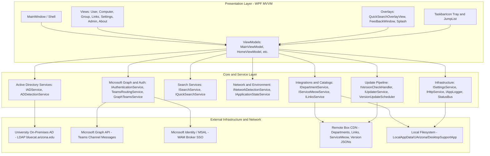
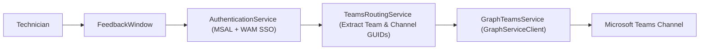
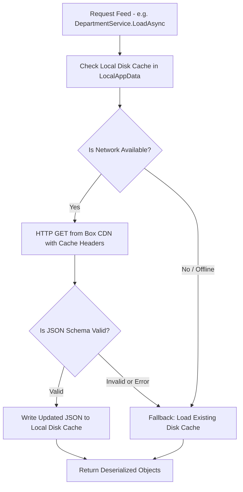
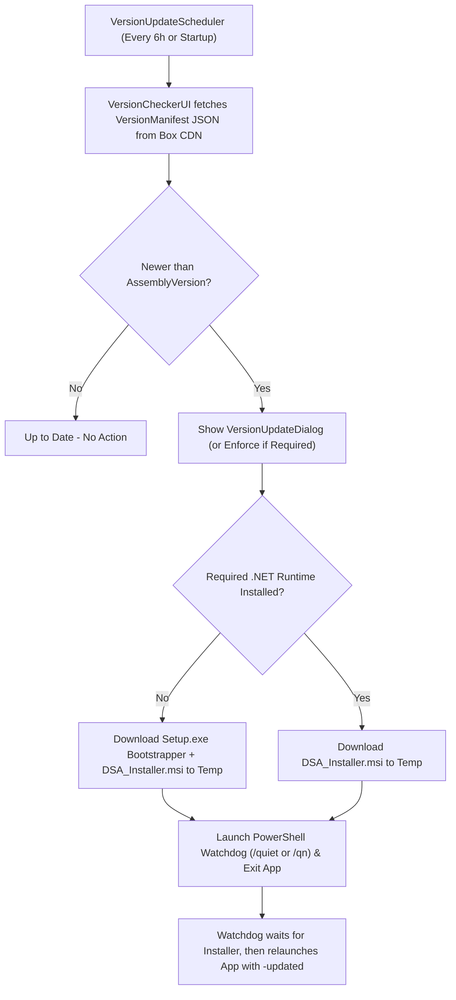

# Desktop Support App (DSA) — Architecture Documentation

This document provides a comprehensive, purely informational technical overview of the Desktop Support App (DSA) codebase and runtime architecture.

- For **release, deployment, and developer extension workflows**, see [**`docs/WORKFLOWS.md`**](WORKFLOWS.md).
- For **JSON schemas and field-by-field data dictionaries**, see [**`docs/SCHEMAS.md`**](SCHEMAS.md).

---

## Table of Contents
1. [Architecture Overview](#1-architecture-overview)
2. [Solution Organization & Project Structure](#2-solution-organization--project-structure)
3. [External Dependencies & NuGet Packages](#3-external-dependencies--nuget-packages)
4. [Presentation Layer & MVVM Implementation](#4-presentation-layer--mvvm-implementation)
5. [Dependency Injection & Service Registration](#5-dependency-injection--service-registration)
6. [Process Lifecycle & Single-Instance IPC](#6-process-lifecycle--single-instance-ipc)
7. [Global QuickSearch Overlay System](#7-global-quicksearch-overlay-system)
8. [Directory Services, Network Awareness & Microsoft Graph](#8-directory-services-network-awareness--microsoft-graph)
   - [On-Premises Active Directory](#on-premises-active-directory)
   - [Domain Controller & Network Detection Heuristics](#domain-controller--network-detection-heuristics)
   - [Microsoft Graph & Teams In-App Feedback Pipeline](#microsoft-graph--teams-in-app-feedback-pipeline)
9. [Data Layer, Resilient Remote Fetching & Caching](#9-data-layer-resilient-remote-fetching--caching)
   - [Remote Feed Schemas & Data Models](#remote-feed-schemas--data-models)
   - [User-Mutable Local Configuration (`AppSettings`)](#user-mutable-local-configuration-appsettings)
10. [Administrative & Developer Tooling (`AdminView` & `DevMode`)](#10-administrative--developer-tooling-adminview--devmode)
11. [Auto-Update Subsystem](#11-auto-update-subsystem)
12. [UI Design System & Theming](#12-ui-design-system--theming)
13. [Storage Layout, Logging & Diagnostics](#13-storage-layout-logging--diagnostics)

---

## 1. Architecture Overview

Desktop Support App is a high-performance Windows desktop application built with **.NET 10** and **WPF (Windows Presentation Foundation)**. It adheres strictly to the **Model-View-ViewModel (MVVM)** architectural pattern with modular service boundaries enforced by inversion of control (`Microsoft.Extensions.DependencyInjection`).

### High-Level Architecture Diagram



### Architectural Principles
- **Offline & Low-Bandwidth Resilience:** Remote data (department indexes, links, pet gallery) utilizes an offline-first caching strategy via [`RemoteWithBackUpLoader`](../DSAMVVM/Core/IO/RemoteWithBackUpLoader.cs). If a network outage occurs, the app seamlessly serves cached data.
- **Strict Separation of Concerns:** Views contain minimal to zero code-behind; all user interactions, business workflows, and asynchronous operations run through ViewModels and injected domain services.
- **Single-Instance with IPC Wakeup:** The application enforces a single-process constraint via a system `Mutex` and communicates with subsequent invocations (e.g., Windows JumpList clicks) via a Named Pipe.
- **Native Security & Zero Secrets:** Microsoft Graph operations utilize interactive MSAL public-client authentication with the Windows Web Account Manager (WAM) Broker, requiring zero stored client secrets.

---

## 2. Solution Organization & Project Structure

The solution [`DSAMVVM.sln`](../DSAMVVM.sln) consists of three primary projects:

```
Desktop-Support/
├── DSAMVVM/                     # Main WPF Application (.NET 10.0-windows10.0.26100.0)
│   ├── App.xaml / App.xaml.cs   # Application entry point, Single-Instance IPC, Startup bootstrap
│   ├── MainWindow.xaml / .cs    # Main shell window with title bar, navigation bar, and view host
│   ├── ServiceRegistration.cs   # Dependency injection container registrations (Core & MVVM)
│   ├── Core/                    # Domain logic, interfaces, platform utilities, and logging
│   │   ├── Enums/               # AppView, NetworkConnectionType, SearchTarget, UpdateStatus
│   │   ├── Formatters/          # Clipboard card formatters for User, Computer, and Group objects
│   │   ├── Interfaces/          # Service contracts divided by functional domain
│   │   ├── IO/                  # JsonFileCache, RemoteWithBackUpLoader
│   │   ├── Logging/             # FileLogger, Log abstraction
│   │   ├── Models/              # Core DTOs, FeedbackPayload, Status items
│   │   ├── Services/            # Service implementations (AD, Graph/Teams, Search, UI, Updates)
│   │   └── Utilities/           # ObservableObject, RelayCommand, UiNotify, VersionChecker
│   ├── MVVM/                    # MVVM presentation layer
│   │   ├── Model/               # Globals, configuration schemas (UI, Search, Shortcuts, etc.)
│   │   ├── Services/            # UI status bus and version check handlers
│   │   ├── View/                # XAML UserControls (Views, Dialogs, Overlays, Helpers, Resources)
│   │   └── ViewModel/           # ViewModels for all navigation targets, dialogs, and cards
│   └── Theme/                   # XAML resources, control styles, colors, and layout geometry
├── DSA.Installer/               # WiX Toolset SDK installer project (.msi)
│   ├── Package.wxs              # MSI components, installation directory, shortcuts, registry keys
│   └── Resources/               # Installer dialog and banner bitmaps
├── DSA.Bootstrapper/            # WiX Toolset SDK bundle project (.exe)
│   ├── Bundle.wxs               # Standard bootstrapper application bundle chain
│   └── Resources/               # Setup wizard logos and sidebars
└── docs/                        # Architectural, operational, and onboarding documentation
    ├── ARCHITECTURE.md          # (This document)
    ├── SCHEMAS.md               # JSON data dictionary & schema reference
    └── WORKFLOWS.md             # Release, deployment, and developer extension workflows
```

---

## 3. External Dependencies & NuGet Packages

DSA intentionally keeps its external dependency footprint lean, relying on official Microsoft libraries and battle-tested open-source packages. Exact package versions are managed in [`DSAMVVM.csproj`](../DSAMVVM/DSAMVVM.csproj), [`DSA.Installer.wixproj`](../DSA.Installer/DSA.Installer.wixproj), and [`DSA.Bootstrapper.wixproj`](../DSA.Bootstrapper/DSA.Bootstrapper.wixproj).

### Application Dependencies ([`DSAMVVM.csproj`](../DSAMVVM/DSAMVVM.csproj))

| Package | Architectural Role & Usage in Codebase |
| :--- | :--- |
| **`Microsoft.Extensions.DependencyInjection`** | Provides the Inversion of Control (IoC) container (`ServiceCollection`, `IServiceProvider`). Configured in [`ServiceRegistration.cs`](../DSAMVVM/ServiceRegistration.cs) and bootstrapped in [`App.xaml.cs`](../DSAMVVM/App.xaml.cs) to manage singleton services and transient ViewModel factories. |
| **`System.DirectoryServices.AccountManagement`** | Brings in the Windows Active Directory / LDAP assemblies (`System.DirectoryServices`, `DirectoryEntry`, `DirectorySearcher`, `SearchResult`). Used in [`ADUserService`](../DSAMVVM/Core/Services/AD/ADUserService.cs), [`ADComputerService`](../DSAMVVM/Core/Services/AD/ADComputerService.cs), [`ADGroupService`](../DSAMVVM/Core/Services/AD/ADGroupService.cs), and [`DirectoryUtility`](../DSAMVVM/Core/Services/AD/DirectoryUtility.cs) to query `LDAP://DC=bluecat,DC=arizona,DC=edu`. |
| **`Microsoft.Identity.Client` (MSAL)** | Core Microsoft Authentication Library (`IPublicClientApplication`, `PublicClientApplicationBuilder`). Used in [`AuthenticationService`](../DSAMVVM/Core/Services/Graph/AuthenticationService.cs) to acquire, cache, and silently refresh OAuth2 / OIDC access tokens against Entra ID (`login.microsoftonline.com`). |
| **`Microsoft.Identity.Client.Broker`** | Extends MSAL with native Windows Web Account Manager (WAM) integration (`WithBroker(new BrokerOptions(...))`). Enables seamless Windows Single Sign-On (SSO) attached to the parent WPF window handle without embedded browser popups or stored secrets. |
| **`Microsoft.Graph` & `Microsoft.Graph.Core`** | Official Microsoft Graph SDK (`GraphServiceClient`, `ChatMessage`, `ItemBody`) and Kiota authentication abstractions (`IAccessTokenProvider`). Used in [`GraphTeamsService`](../DSAMVVM/Core/Services/Graph/GraphTeamsService.cs) and [`FeedbackWindowViewModel`](../DSAMVVM/MVVM/ViewModel/Dialogs/FeedbackWindowViewModel.cs) to post structured HTML bug reports, feature requests, and diagnostics directly into Microsoft Teams channels. |
| **`Newtonsoft.Json`** | High-flexibility JSON serializer (`JsonConvert`, `JObject`, `[JsonProperty]`, `[JsonIgnore]`). Used across [`SettingsService`](../DSAMVVM/Core/Services/Infrastructure/SettingsService.cs), [`JsonFileCache`](../DSAMVVM/Core/IO/JsonFileCache.cs), [`RemoteWithBackUpLoader`](../DSAMVVM/Core/IO/RemoteWithBackUpLoader.cs), [`DepartmentService`](../DSAMVVM/Core/Services/Integrations/DepartmentService.cs), [`LinksService`](../DSAMVVM/Core/Services/Integrations/LinksService.cs), [`ServiceMeowService`](../DSAMVVM/Core/Services/Integrations/ServiceMeowService.cs), and [`VersionChecker`](../DSAMVVM/Core/Utilities/VersionChecker.cs) for fault-tolerant parsing and schema migration. |
| **`SharpHook`** | Low-level cross-platform global keyboard hook (`TaskPoolGlobalHook`) and input simulator (`EventSimulator`). Used in [`QuickSearchService`](../DSAMVVM/Core/Services/Search/QuickSearchService.cs) to detect double-tap modifier hotkeys and simulate `Ctrl+C` text capture, triggering [`QuickSearchOverlayView`](../DSAMVVM/MVVM/View/Overlays/QuickSearchOverlayView.xaml). |
| **`H.NotifyIcon.Wpf`** | Modern WPF system tray implementation (`TaskbarIcon`). Defined in [`TrayIcon.xaml`](../DSAMVVM/MVVM/View/Resources/TrayIcon.xaml) and managed in [`App.xaml.cs`](../DSAMVVM/App.xaml.cs) to provide a persistent system tray icon, double-click window restoration, and right-click context menu. |

### Packaging & Installer Dependencies ([`DSA.Installer`](../DSA.Installer/DSA.Installer.wixproj) & [`DSA.Bootstrapper`](../DSA.Bootstrapper/DSA.Bootstrapper.wixproj))

| Package / SDK | Architectural Role & Usage |
| :--- | :--- |
| **`WixToolset.Sdk`** | MSBuild SDK for compiling WiX `.wxs` definitions into Windows Installer (`.msi`) and Bundle (`.exe`) packages automatically during `dotnet build` without requiring a separate global tool install. |
| **`WixToolset.UI.wixext`** | Provides standard MSI installation wizard dialogs (`WixUI_InstallDir`) customized in [`Package.wxs`](../DSA.Installer/Package.wxs). |
| **`WixToolset.Util.wixext`** | Provides utility custom actions such as `util:CloseApplication` (gracefully prompting to close DSA before upgrade) and `WixShellExec` (launching the app after install). |
| **`WixToolset.BootstrapperApplications.wixext`** | Provides `WixStandardBootstrapperApplication` in [`Bundle.wxs`](../DSA.Bootstrapper/Bundle.wxs) to wrap the MSI into a branded `DSA_Setup.exe` bundle. |

---

## 4. Presentation Layer & MVVM Implementation

> [!TIP]
> **New to MVVM or WPF Data Binding?**
> For general background on the Model-View-ViewModel pattern, see:
> - [Model-View-ViewModel (MVVM) Pattern — Microsoft Learn](https://learn.microsoft.com/en-us/dotnet/architecture/maui/mvvm)
> - [WPF Data Binding Overview — Microsoft Learn](https://learn.microsoft.com/en-us/dotnet/desktop/wpf/data/)
> - [Model–view–viewmodel — Wikipedia](https://en.wikipedia.org/wiki/Model%E2%80%93view%E2%80%93viewmodel)

### DSA-Specific MVVM Primitives
Rather than using a third-party MVVM toolkit, DSA uses two lightweight primitives in [`DSAMVVM/Core/Utilities/`](../DSAMVVM/Core/Utilities/):
- **[`ObservableObject`](../DSAMVVM/Core/Utilities/ObservableObject.cs):** Base class implementing `INotifyPropertyChanged` with `Set<T>(ref field, value)` and `[CallerMemberName]` support.
- **[`RelayCommand`](../DSAMVVM/Core/Utilities/RelayCommand.cs):** `ICommand` implementation hooking into `CommandManager.RequerySuggested` for `execute` and `canExecute` delegates.

### ViewModel-First Navigation (`App.xaml` DataTemplates)
[`MainWindow.xaml`](../DSAMVVM/MainWindow.xaml) hosts a `<ContentControl Content="{Binding CurrentView}" />` governed by [`MainViewModel`](../DSAMVVM/MVVM/ViewModel/MainViewModel.cs). Switching `SelectedView` ([`AppView`](../DSAMVVM/Core/Enums/AppView.cs) enum) updates `CurrentView`, which WPF resolves automatically via implicit `<DataTemplate DataType="{x:Type viewModel:...}">` mappings declared in [`App.xaml`](../DSAMVVM/App.xaml#L17-L44).

### ViewModel Lifetimes & Card ViewModels
Configured in [`ServiceRegistration.cs`](../DSAMVVM/ServiceRegistration.cs):
- **Singleton ViewModels:** Retain state throughout the app lifecycle (`MainViewModel`, `HomeViewModel`, `StatusBarViewModel`, `AboutViewModel`, `AdminViewModel`).
- **Transient ViewModels via Factories:** Resolved lazily via `Func<TViewModel>` delegates (`UserViewModel`, `ComputerViewModel`, `GroupViewModel`, `LinksViewModel`, `QuickSearchOverlayViewModel`, and `EntraViewModel` *(internal auth/Graph diagnostic test harness)*).
- **Card / History Item ViewModels (`MVVM/ViewModel/Cards/`):** Search results are wrapped in [`UserHistoryItemViewModel`](../DSAMVVM/MVVM/ViewModel/Cards/UserHistoryItemViewModel.cs), [`ComputerHistoryItemViewModel`](../DSAMVVM/MVVM/ViewModel/Cards/ComputerHistoryItemViewModel.cs), and [`GroupHistoryItemViewModel`](../DSAMVVM/MVVM/ViewModel/Cards/GroupHistoryItemViewModel.cs) inside each view's `History` collection.
- **Shared Search Contract ([`ISearchableViewModel`](../DSAMVVM/Core/Interfaces/Search/ISearchableViewModel.cs)):** Allows `MainViewModel` to forward queries from the top search bar to the active view via `OnSearchUpdated(SearchContextDTO, ...)`.

### Global Event & Status Bus
Decoupled UI notifications and status bar items are propagated via:
- [`StatusBus`](../DSAMVVM/MVVM/Services/Status/StatusBus.cs): Thread-safe observable collection of active status indicators (network status, update notifications, background sync operations).
- [`UiNotify`](../DSAMVVM/Core/Utilities/UINotify.cs): Static messaging hub providing unified APIs (`UiNotify.Info`, `UiNotify.Warn`, `UiNotify.Error`, `UiNotify.Success`) to publish status bar messages from anywhere in the codebase.

---

## 5. Dependency Injection & Service Registration

The DI container is configured at startup in [`App.xaml.cs`](../DSAMVVM/App.xaml.cs#L564) using [`ServiceRegistration.cs`](../DSAMVVM/ServiceRegistration.cs), utilizing C# extension methods on `IServiceCollection`:

```csharp
public static class ServiceRegistration
{
    extension(IServiceCollection services)
    {
        public IServiceCollection AddCoreServices() { ... }
        public IServiceCollection AddViewModels() { ... }
    }
}
```

### Injected Service Overview
| Interface | Implementation | Lifetime | Purpose |
| :--- | :--- | :--- | :--- |
| [`IAppLogger`](../DSAMVVM/Core/Interfaces/Infrastructure/IAppLogger.cs) | [`FileLogger`](../DSAMVVM/Core/Logging/FileLogger.cs) | Singleton | Rolling daily disk logger in `%LocalAppData%\UArizona\DesktopSupportApp\logs`. |
| [`IHttpService`](../DSAMVVM/Core/Interfaces/Infrastructure/IHttpService.cs) | [`HttpService`](../DSAMVVM/Core/Services/Infrastructure/HttpService.cs) | Singleton | Centralized resilient HTTP client with timeouts, retry, and caching headers. |
| [`ISettingsService`](../DSAMVVM/Core/Interfaces/Infrastructure/ISettingsService.cs) | [`SettingsService`](../DSAMVVM/Core/Services/Infrastructure/SettingsService.cs) | Singleton | Asynchronous persistence and loading of `settings.json` with schema validation. |
| [`INetworkDetectionService`](../DSAMVVM/Core/Interfaces/Infrastructure/INetworkDetectionService.cs) | [`NetworkDetectionService`](../DSAMVVM/Core/Services/Infrastructure/NetworkDetectionService.cs) | Singleton | Real-time network interface monitoring (Cisco VPN, Campus Wired, `UAWiFi`, Off-Campus, APIPA). |
| [`IADService`](../DSAMVVM/Core/Interfaces/AD/IADService.cs) | [`ADService`](../DSAMVVM/Core/Services/AD/ADService.cs) | Singleton | Facade for Users, Computers, and Groups on-premise AD queries. |
| [`IADDetectionService`](../DSAMVVM/Core/Interfaces/AD/IADDetectionService.cs) | [`ADDetectionService`](../DSAMVVM/Core/Services/AD/ADDetectionService.cs) | Singleton | Domain controller DNS, TCP port 389 handshake latency, and LDAP `RootDSE` fast-bind probe (`bluecat.arizona.edu`). |
| [`IAuthenticationService`](../DSAMVVM/Core/Interfaces/Graph/IAuthenticationService.cs) | [`AuthenticationService`](../DSAMVVM/Core/Services/Graph/AuthenticationService.cs) | Singleton | Interactive MSAL token acquisition via Windows WAM broker for corporate SSO and Graph API authentication. |
| [`TeamsRoutingService`](../DSAMVVM/Core/Services/Graph/TeamsRoutingService.cs) | [`TeamsRoutingService`](../DSAMVVM/Core/Services/Graph/TeamsRoutingService.cs) | Singleton | Dynamically resolves target Microsoft Teams channel GUIDs from user token claims and Box configuration. |
| [`IAdminService`](../DSAMVVM/Core/Interfaces/Integrations/IAdminService.cs) | [`AdminService`](../DSAMVVM/Core/Services/Integrations/AdminService.cs) | Singleton | Powers in-app editing and schema-validated JSON export for Departments, Support Teams, Links, and ServiceMeow data. |
| [`ISearchService`](../DSAMVVM/Core/Interfaces/Search/ISearchService.cs) | [`SearchService`](../DSAMVVM/Core/Services/Search/SearchService.cs) | Singleton | Aggregates and dispatches search queries to relevant target providers. |
| [`IQuickSearchService`](../DSAMVVM/Core/Interfaces/Search/IQuickSearchService.cs) | [`QuickSearchService`](../DSAMVVM/Core/Services/Search/QuickSearchService.cs) | Singleton | Global keyboard hook listening for QuickSearch hotkey triggers. |
| [`IUpdaterService`](../DSAMVVM/Core/Interfaces/Updates/IUpdaterService.cs) | [`UpdaterService`](../DSAMVVM/Core/Services/Updates/UpdaterService.cs) | Singleton | Downloads MSI/bootstrapper installers, checks required .NET runtime, launches quiet install via PowerShell watchdog, and cleans up old temp files. |

---

## 6. Process Lifecycle & Single-Instance IPC

To prevent multiple instances from conflicting over hotkeys, cache files, and system tray icons, [`App.xaml.cs`](../DSAMVVM/App.xaml.cs) enforces a single-instance lifecycle:

1. **Mutex Check (`DSAMVVM_Mutex_Global_v1`):** On startup, the app attempts to acquire a named system `Mutex`.
2. **Named Pipe Client (`DSAMVVM_Pipe_Channel_v1`):** If the mutex is already held by an existing instance, the secondary process connects to the named pipe via [`SendArgsToFirstInstanceAsync`](../DSAMVVM/App.xaml.cs#L346), forwards its command-line arguments (or a `"WAKE_UP"` signal), and immediately shuts down.
3. **Named Pipe Server & Routing:** The primary instance listens asynchronously in [`ListenForArgumentsAsync`](../DSAMVVM/App.xaml.cs#L368). When a payload arrives, it restores and focuses `MainWindow` and passes the arguments to [`MainViewModel.ProcessArgs`](../DSAMVVM/MVVM/ViewModel/MainViewModel.cs#L497).

### Command-Line Arguments Reference
The argument parser in [`MainViewModel.ProcessArgs`](../DSAMVVM/MVVM/ViewModel/MainViewModel.cs#L497) supports the following switches (used by Windows Taskbar Jump Lists and post-update relaunches):

| Argument | Values / Format | Description |
| :--- | :--- | :--- |
| `--mode` | `user`, `computer`, `group`, `links`, `settings`, `about`, `entra`, `update` | Directs the app to switch to the specified view immediately. |
| `--query` | `<string>` | Populates the search input and executes the search command automatically. |
| `--group-mode` / `--groupmode` | `mim`, `members`, `dept`, `div` | Configures the group search mode (User MIM, Group Members, Department, or Division). |
| `--section` / `--tab` / `--card` | Categories: `appearance` (`ui`), `data-links` (`links`), `quicksearch` (`search`), `system` (`maintenance`)<br/>Cards: `shortcuts`, `links-mode`, `data`, `tray`, `history`, `font`, `quicksearch`, `updates`, `logs`, `reset` | Navigates to a specific Settings category or scrolls to a specific card anchor via `ResolveSettingsTarget`. |
| `-updated` | *(flag)* | Relaunch indicator used after an automated update; triggers About view and a success notification. |

> [!NOTE]
> **PowerShell vs. `dotnet run` Invocation:**
> - When invoking the compiled binary (`Desktop Support App.exe`) in PowerShell, prefix the quoted path with the PowerShell call operator `&` (e.g., `& ".\Desktop Support App.exe" --mode user`).
> - When invoking via the .NET CLI, include the `--` argument separator so `dotnet run` passes the flags to the application rather than MSBuild (e.g., `dotnet run --project DSAMVVM -- --mode user`).

---

## 7. Global QuickSearch Overlay System

DSA incorporates a system-wide QuickSearch feature powered by **SharpHook** (`TaskPoolGlobalHook` and `EventSimulator`).

### Architecture of QuickSearch
1. **Hook Listening:** [`QuickSearchService`](../DSAMVVM/Core/Services/Search/QuickSearchService.cs) registers a background `TaskPoolGlobalHook` that monitors key-press and key-release events across the operating system.
2. **Double-Tap Modifier Detection:** Rather than a multi-key chord, QuickSearch triggers when the technician **double-taps a single modifier key** (default `KeyCode.VcLeftControl` / Left `Ctrl`, configurable in `QuickSearchSettings`) within `DoubleTapThresholdMs` (default 350ms, with a `>50ms` key-repeat debounce; pressing any other key in between cancels the sequence).
3. **Simulated `Ctrl+C` Selection Capture:** When a valid double-tap is detected, `ExecuteCapture()` backs up the current Windows clipboard text, uses `SharpHook.Simulation.EventSimulator` to release active modifiers and synthesize a `Ctrl+C` keystroke to copy whatever text is highlighted in the foreground application (browser, ticket, chat), and restores the original clipboard contents afterward.
4. **Inline Overlay Presentation:** The service raises `OnQuickSearchTriggered(string capturedText)`, causing [`App.xaml.cs`](../DSAMVVM/App.xaml.cs#L173) to present [`QuickSearchOverlayView`](../DSAMVVM/MVVM/View/Overlays/QuickSearchOverlayView.xaml) backed by [`QuickSearchOverlayViewModel`](../DSAMVVM/MVVM/ViewModel/Overlays/QuickSearchOverlayViewModel.cs) (which sanitizes and pre-populates captured text up to 30 characters).
5. **Targeted Inline Lookup & Deep-Linking:** From the overlay, the technician selects **User**, **Computer**, or **Group** (which opens a `1–4` sub-menu for User MIM, AD Group Members, Department Support, or Division Support) to execute the lookup and render the result card (`UserHistoryItemViewModel`, `ComputerHistoryItemViewModel`, or `GroupHistoryItemViewModel`) directly inside the overlay popup, with one-click deep-linking (`OpenInMainAppCommand`) into the main application window.

---

## 8. Directory Services, Network Awareness & Microsoft Graph

### On-Premises Active Directory
- **LDAP Root:** `LDAP://DC=bluecat,DC=arizona,DC=edu` (defined in [`Globals`](../DSAMVVM/MVVM/Model/globals.cs#L22)).
- **Implementation:** [`ADService`](../DSAMVVM/Core/Services/AD/ADService.cs) and [`DirectoryUtility`](../DSAMVVM/Core/Services/AD/DirectoryUtility.cs) use `System.DirectoryServices` (`DirectoryEntry` and `DirectorySearcher`) across three specialized domain services:
  - [`ADUserService`](../DSAMVVM/Core/Services/AD/ADUserService.cs): Searches by NetID (`sAMAccountName`) or `employeeID`. Reads `displayName`, enabled status (`userAccountControl`), account lockout flag (`GetLockedQuick`), `department` (extracting the 4-digit department number), `eduPersonPrimaryAffiliation`, Microsoft 365 license status from `extensionAttribute15` (`ParseLicense`), `UA-MIM-Wrkst-AllDivUsers` membership, 4-character division code from `MIM-DivisionRollup` groups, and Adobe Acrobat Pro / Creative Cloud group entitlements (`adobesync-acrobat-pro`, `adobesync-cc-campus`, `adobesync-cc-student`).
  - [`ADComputerService`](../DSAMVVM/Core/Services/AD/ADComputerService.cs): Searches by hostname (`cn`). Reads `distinguishedName` (formatted into a readable `OU=...` hierarchy via `FormatDN`), `description`, `operatingSystem`, enabled state (`userAccountControl`), Entra Hybrid Joined group membership (`UA-MEMHybridDevices`), and `lastLogonTimestamp`.
  - [`ADGroupService`](../DSAMVVM/Core/Services/AD/ADGroupService.cs): Powers the four lookup modes in [`GroupViewModel`](../DSAMVVM/MVVM/ViewModel/GroupViewModel.cs):
    1. **User MIM (`mim`):** Retrieves a user's `MIM` groups (`GetUserMimGroupsAsync`).
    2. **Group Members (`members`):** Uses ranged LDAP attribute retrieval (`member;range=0-1499`) in `GetGroupMembersInfoAsync` to enumerate large AD groups without hitting standard LDAP page size limits.
    3. **Department (`dept`):** Cross-references a 4-digit department number against `DepartmentService` (`departments.json`) and AD groups.
    4. **Division (`div`):** Cross-references a 4-character division code against `SupportTeams` in `departments.json`.

### Domain Controller & Network Detection Heuristics
- **Domain Controller Probe ([`ADDetectionService`](../DSAMVVM/Core/Services/AD/ADDetectionService.cs)):** Rather than relying on ICMP ping (which is frequently filtered by firewalls), `ProbeDomainControllerAsync()` executes a 3-stage check against `bluecat.arizona.edu`:
  1. **DNS Resolution:** Resolves IPv4/IPv6 records via `Dns.GetHostAddressesAsync` (1500ms timeout).
  2. **TCP Port 389 Handshake:** Opens a `TcpClient` socket to port `389` and measures exact round-trip connection latency with a `Stopwatch`.
  3. **LDAP `RootDSE` FastBind:** Queries `LDAP://bluecat.arizona.edu/RootDSE` (`AuthenticationTypes.FastBind | AuthenticationTypes.ReadonlyServer`) to verify the directory service is actively responding.
- **Network Classification ([`NetworkDetectionService`](../DSAMVVM/Core/Services/Infrastructure/NetworkDetectionService.cs)):** Subscribes to `NetworkChange` events (debounced by 600ms) and evaluates active physical network adapters in priority order:
  1. **VPN (`NetworkConnectionType.Vpn`):** Active adapter matching `Cisco Secure Client` or `Cisco AnyConnect`.
  2. **Campus Wired (`NetworkConnectionType.CampusWired`):** Non-virtual Ethernet adapter with an `arizona.edu` DNS suffix or campus DNS server IP (`128.196.*` or `150.135.*`).
  3. **Campus Wi-Fi (`NetworkConnectionType.CampusWiFi`):** Wireless adapter whose connected SSID (queried via `netsh wlan show interfaces`) is `UAWiFi`. Connections to `eduroam` or `UAGuest` are classified as **Off-Campus** with a warning that Cisco VPN is required for internal access.
  4. **Off-Campus (`NetworkConnectionType.OffCampus`):** Any other physical adapter with a valid non-loopback, non-APIPA IPv4 address.
  5. **Disconnected / APIPA (`NetworkConnectionType.Disconnected`):** No active adapters, or a physical adapter stuck on a `169.254.x.x` self-assigned address (DHCP failure).

### Microsoft Graph & Teams In-App Feedback Pipeline
The application utilizes Microsoft Graph API to enable support technicians to submit bug reports, diagnostic logs, and feature requests directly into internal Microsoft Teams channels without needing external forms:



#### Key Architecture Components:
- **Zero-Secret Public Client:** [`AuthenticationService`](../DSAMVVM/Core/Services/Graph/AuthenticationService.cs) initiates an MSAL interactive authentication flow with the native Windows Web Account Manager (`WithBroker(new BrokerOptions(BrokerOptions.OperatingSystems.Windows))`).
- **Dynamic Routing:** [`TeamsRoutingService`](../DSAMVVM/Core/Services/Graph/TeamsRoutingService.cs) parses user token claims (`roles`) or Box CDN configurations to resolve destination Teams channel GUIDs.
- **Message Dispatch:** [`GraphTeamsService`](../DSAMVVM/Core/Services/Graph/GraphTeamsService.cs) uses `GraphServiceClient` with an [`InlineTokenProvider`](../DSAMVVM/Core/Services/Graph/GraphTeamsService.cs) to deliver structured HTML payloads with system environment diagnostics.
- **Fallback Webhook:** If Graph authentication is unavailable, [`RawHTTPTeamsService`](../DSAMVVM/Core/Services/Graph/RawHTTPTeamsService.cs) is available as an alternative HTTP delivery route.

> [!NOTE]
> Microsoft Graph is currently utilized specifically for **in-app bug reporting, feature requests, and diagnostic messaging**. All directory queries (Users, Computers, Groups) are queried from on-premises Active Directory (LDAP). Directory object lookups via Graph/Entra are not currently implemented.

---

## 9. Data Layer, Resilient Remote Fetching & Caching

A core design goal of DSA is that **organizational data (departments, support teams, links, and pet profiles) is decoupled from the compiled application binary**. Instead of requiring a code change and software release whenever a department changes support teams or a new campus tool link is added, DSA fetches mutable JSON datasets from the University Box CDN and caches them locally.

> [!TIP]
> **Full JSON Schema & Data Dictionary:** See [**`docs/SCHEMAS.md`**](SCHEMAS.md) for annotated JSON examples and field-by-field definitions for `Version.json`, `departments.json`, `links.json`, `servicemeow.json`, and `settings.json`.



### Core Fetching & Caching Components
- [`RemoteWithBackUpLoader`](../DSAMVVM/Core/IO/RemoteWithBackUpLoader.cs): Encapsulates HTTP download, schema version validation (`JsonMetaBase`), automatic fallback to the local disk cache on network/parse failure, and background cache updates.
- [`JsonFileCache`](../DSAMVVM/Core/IO/JsonFileCache.cs): Handles low-level atomic reading and writing of JSON cache files in `%LOCALAPPDATA%\UArizona\DesktopSupportApp\data\`.

### Remote Feed Schemas & Data Models
Each remote JSON feed contains a `Meta` header inheriting from [`JsonMetaBase`](../DSAMVVM/MVVM/Model/Schemas/JSONMetaBase.cs) (`SchemaVersion`, `LastUpdatedUtc`) validated against the active schema constants defined in [`Globals.cs`](../DSAMVVM/MVVM/Model/globals.cs#L58-L62):

| Dataset / Feed | Model Class | Schema Constant in `Globals` | Local Cache File | Contents & Mutability |
| :--- | :--- | :--- | :--- | :--- |
| **Departments & Support Teams** | [`DepartmentListWrapper`](../DSAMVVM/MVVM/Model/Data/DepartmentData.cs) | `g_DepartmentJSONSchema` | `data\departments.json` | Maps 4-digit UArizona department numbers (`DepartmentList`) to their assigned IT `Team`, `SupportKnown` flag, `Notes`, and `FileRepoPath`, plus `SupportTeams` (managers, NetIDs, phone numbers, and supported division codes). |
| **Links Directory** | [`LinksData`](../DSAMVVM/MVVM/Model/Data/LinksData.cs) | `g_LinkJSONSchema` | `data\links.json` | Contains `CommonLinks` (shared campus-wide portals/tools) and `TeamLinks` (links grouped by specific support team). |
| **ServiceMeow** | [`ServiceMeowData`](../DSAMVVM/MVVM/Model/Data/ServiceMeowData.cs) | `g_ServiceMeowJSONSchema` | `data\servicemeow.json` | Contains `Owners` (NetID, Name, Team) and their `Pets` (Name, Title, Breed, Species, Blurb, and remote image URLs cached into `img\sm\`). |
| **Version Manifest** | [`VersionManifest`](../DSAMVVM/MVVM/Model/Schemas/VersionSchema.cs) | `g_VersionSchema` | *(In-memory check)* | Defines `Current` and `PreRelease` versions, `Required` update thresholds, `MsiUrl`, `SetupUrl` (.NET bootstrapper), and `RequiredDotNetVersion`. |

### User-Mutable Local Configuration (`AppSettings`)
Separate from the shared organizational feeds above, per-technician preferences are stored locally in `%LOCALAPPDATA%\UArizona\DesktopSupportApp\settings.json` (managed by [`SettingsService`](../DSAMVVM/Core/Services/Infrastructure/SettingsService.cs), validated against `Globals.g_SettingsSchema`):
- **Home Screen Shortcuts ([`HomeShortcutsSettings`](../DSAMVVM/MVVM/Model/Config/UI/HomeShortcutsSettings.cs)):** Users can customize, reorder, recolor, add, or remove personal shortcut tiles on the `HomeView` dashboard.
- **Pinned & Custom Links ([`LinksSettings`](../DSAMVVM/MVVM/Model/Config/UI/LinksSettings.cs)):** Users can filter team links and maintain personal preferences within `LinksView`.
- **QuickSearch & UI Preferences:** Global hotkey bindings ([`QuickSearchSettings`](../DSAMVVM/MVVM/Model/Config/QuickSearchSettings.cs)), base font scaling ([`FontSettings`](../DSAMVVM/MVVM/Model/Config/UI/FontSettings.cs)), search history retention ([`SearchSettings`](../DSAMVVM/MVVM/Model/Config/UI/SearchSettings.cs)), and system tray behavior ([`TraySettings`](../DSAMVVM/MVVM/Model/Config/UI/TraySettings.cs)).
- **Schema Migration Backup:** If `settings.json` has an older schema version on startup, `SettingsService` backs up the previous file into `settings-legacy\` and clamps/applies defaults via `AppSettings.ApplyDefaultsAndClamp()`.

---

## 10. Administrative & Developer Tooling (`AdminView` & `DevMode`)

Because the organizational JSON feeds (`departments.json`, `links.json`, `servicemeow.json`) are mutable over time, DSA includes a built-in administrative editor so maintainers never have to hand-edit raw JSON files.

### In-App JSON Dataset Editor (`AdminView`)
Managed by [`AdminViewModel`](../DSAMVVM/MVVM/ViewModel/AdminViewModel.cs), [`AdminService`](../DSAMVVM/Core/Services/Integrations/AdminService.cs), and [`JsonExportService`](../DSAMVVM/Core/Services/Infrastructure/JsonExportService.cs):
- **Admin Mode State:** Toggling **Admin Mode** (`MainViewModel.ToggleAdminModeCommand` / `IApplicationStateService`) reveals the **Admin** view in the navigation sidebar.
- **Working Copy & Export:** `AdminService` loads the current dataset from the local working directory or `data\` cache into editable forms inside `AdminView` for **Departments**, **Support Teams**, **Links**, or **ServiceMeow**, and `IJsonExportService` serializes the updated dataset with normalized `Meta` headers (`LastUpdatedUtc` and `SchemaVersion`).

### Developer Mode (`DevMode`) & Staging Feeds
- Controlled via [`IApplicationStateService`](../DSAMVVM/Core/Interfaces/Infrastructure/IApplicationStateService.cs) and persisted in `AppSettings`.
- When enabled, the application can target staging/test Box JSON URLs defined in [`Globals.cs`](../DSAMVVM/MVVM/Model/globals.cs) (such as `g_TestVersionJSON` and `g_DepartmentTestJSONURL`) to verify schema changes or test installer updates before promoting them to production.

---

## 11. Auto-Update Subsystem

DSA includes an integrated background updater to keep support workstations synchronized with the latest deployment, including automatic .NET Desktop Runtime prerequisite checks:



### Core Update Components
- [`VersionUpdateScheduler`](../DSAMVVM/Core/Services/Updates/VersionUpdateScheduler.cs): Background timer triggering periodic update checks (every 6 hours by default).
- [`VersionCheckerUI`](../DSAMVVM/MVVM/Services/Updates/VersionCheckerUI.cs) & [`VersionChecker`](../DSAMVVM/Core/Utilities/VersionChecker.cs): Fetches [`VersionManifest`](../DSAMVVM/MVVM/Model/Schemas/VersionSchema.cs) (supporting both `Current` production and `PreRelease` channels, plus `Required` minimum version enforcement) and presents [`VersionUpdateDialog`](../DSAMVVM/MVVM/View/Dialogs/VersionUpdateDialog.xaml).
- [`UpdaterService`](../DSAMVVM/Core/Services/Updates/UpdaterService.cs):
  - **.NET Runtime Detection:** Checks `C:\Program Files\dotnet\shared\Microsoft.WindowsDesktop.App` against `RequiredDotNetVersion`. If the workstation needs a newer .NET runtime, it downloads both `SetupUrl` (`setup.exe`) and `MsiUrl` (`DSA_Installer.msi`); otherwise, it downloads only `DSA_Installer.msi`.
  - **PowerShell Watchdog Relaunch:** Spawns a hidden PowerShell process that runs `msiexec.exe /i "DSA_Installer.msi" /qn /norestart` (or `setup.exe /quiet /norestart`) with `-Wait`, shuts down the running app so files can be overwritten, and automatically relaunches the app with the `-updated` flag once installation finishes.
  - **Temp Cleanup:** `CleanupOldUpdatesAsync()` purges leftover `DSA_Update_*` directories in `%TEMP%` on startup.

---

## 12. UI Design System & Theming

### University Branding
The UI strictly adheres to University of Arizona branding standards:
- **Primary Navy:** `#0C234B` (Arizona Blue)
- **Primary Red:** `#AB0520` (Arizona Red)
- **Accent Blues:** `#1E5288` (Oasis), `#378DBD` (Sky Blue)
- **Status Colors:** Success `#3CD070`, Warning `#FFB020`, Error `#FF5A5A`

Styles and resources are defined modularly in [`DSAMVVM/Theme/`](../DSAMVVM/Theme/):
- `Colors/Colors.UA.xaml`: Core color brushes.
- `Controls/`: Control templates for cards, rounded buttons, custom search boxes, scrollbars, and tooltips.
- `Decor/`: Gradient brushes, window drop shadows, and visual effects.

### Modern Windows Integration
- [`WindowBackdropHelper`](../DSAMVVM/MVVM/View/Helpers/WindowBackdropHelper.cs): Applies modern Windows 11 system backdrop effects (Mica / Acrylic) using the DWM API (`DwmSetWindowAttribute`).
- [`TaskbarOverlayHelper`](../DSAMVVM/MVVM/View/Helpers/TaskbarOverlayHelper.cs): Controls taskbar badge overlays and progress bars.
- Dynamic typography scaling: [`CardTypography`](../DSAMVVM/MVVM/Model/Config/UI/CardTypography.cs) scales text elements dynamically when the user adjusts base font sizing in Settings.

---

## 13. Storage Layout, Logging & Diagnostics

Both the per-user MSI installation binaries ([`Package.wxs`](../DSA.Installer/Package.wxs#L48-L54)) and all runtime data are stored under `%LOCALAPPDATA%\UArizona\DesktopSupportApp\`:

```
%LOCALAPPDATA%\UArizona\DesktopSupportApp\
├── App\                       # Per-user MSI installation directory ("Desktop Support App.exe" & DLLs)
├── settings.json              # Active user configuration and preferences
├── data\                      # Resilient offline cache files
│   ├── departments.json       # Cached departmental directory
│   ├── links.json             # Cached quick links catalog
│   └── servicemeow.json       # Cached ServiceMeow pet gallery
├── img\                       # Downloaded and cached image assets
│   └── sm\                    # ServiceMeow pet photos
├── logs\                      # Application log files
│   ├── app-2026-10-22.log
│   └── app-2026-10-23.log
└── settings-legacy\           # Automated backups of previous settings schemas
```

### Logging Framework
- [`FileLogger`](../DSAMVVM/Core/Logging/FileLogger.cs) implements [`IAppLogger`](../DSAMVVM/Core/Interfaces/Infrastructure/IAppLogger.cs).
- Log calls are structured: `Log.Debug(category, message)`, `Log.Info(...)`, `Log.Warn(...)`, `Log.Error(...)`.
- Log retention automatically purges historical logs exceeding the retention window configured in settings.
